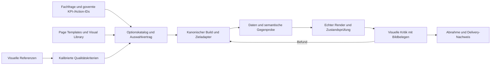

# Reportqualität: Quellen und Fortsetzung

Die bestehende Arbeit wird am **Visuellen Baukasten vom 25.10.2026** fortgesetzt.
Die älteren ALUCA-Konzepte bleiben Hintergrund; aktuelle Entscheidungen, Code und
gemessene Ausgabe gehen bei Widersprüchen vor. Dieses Dokument ist Quellenaufnahme
und Arbeitsliste, kein neuer konkurrierender Designstandard.

## 1. Rekonstruierter Übergabepunkt

- Claude-Sitzung [Fabric Apps](https://claude.ai/code/cshk_01Fx4eMjj6abdCBZRv1UHuxfMDkg1NnJd6aFgsocmvqEeT)
  im angemeldeten Browser gelesen: letzter sichtbarer Abschluss vom 26.10., PR #754
  (Ebene 0) und #755 (r3f-Fix) gemergt; Ebene 1 noch nicht gestartet. Kein vollständiger
  Export der langen Sitzung erstellt; die Rekonstruktion stützt sich zusätzlich auf Repo-Artefakte.
- Freelancing lokal: `main = origin/main = 06a68e8227767509423d4a1f308aa1403637fc7e`;
  `9c88d2618` (#755) enthalten. **Ohne Fetch** geprüft, keine Aussage über spätere Remote-Änderungen.
- ALUCA-Ausgangsstand: `bc0bd33d2ad5ce571e92088ad90931d1dbcad22d`.
- [Freigegebener Plan](../../../Freelancing/docs/plans/2026-10-25_Plan_Visueller_Baukasten.md):
  D-825–828, werkzeugneutraler Kern, stärkste Ausprägung je Ziel, Schrift je Zielklasse.
- [Optionskatalog](../../../Freelancing/meridian/design/katalog/optionskatalog.json):
  Version 0.2.0, 38 Achsen, 130 Optionen, weiterhin **Entwurf**.
- [Klickbarer Katalog](../../../Freelancing/meridian/organisations/aurora/design/design-katalog.html)
  ist der vorhandene Review-Arbeitsplatz; keinen zweiten Konfigurator bauen.
- [Rundenbericht](../../../Freelancing/docs/runden/2026-10-25_Bericht_baukasten-ebene0.md)
  enthält zehn offene Fragen (Zeilen 372–409). Auch die letzte Claude-Antwort führt
  zehn Empfehlungen auf; Wortlaut und Gruppierung unterscheiden sich. Beides ist
  **keine Freigabe**. Insbesondere Schema-Verengung, Defaults und Token-Konsolidierung
  nicht aus Schweigen ableiten.

## 2. Claude-Artefakte: Inhalte und Verwendungsgrenzen

| Quelle | Gelesen / gesichtet | Nutzen und Grenze |
|---|---|---|
| [Aurora Design Drop](../../../Freelancing/Brand/claude_design_drops/fSHo1is15qF9BHwuI7mNLg/_MANIFEST.md) | Manifest, `aurora_reports/report.jsx`, `aurora_page_templates/tpl-001.jsx` | Referenz für KPI → Trend → Aufschlüsselung → Handlung sowie sechs Seitentemplates. `report.jsx` konstruiert Zeitreihen und Regionen mit `seedFor`; Werte und Story sind **keine fachlichen Belege**. |
| [Meridian Report Layout](../../../Freelancing/Brand/claude_design_drops/-8Oo4ccY8u7eMDjiXeq8Vg/_MANIFEST.md) | Manifest, Einstieg `project/Meridian Report Layout.html`, Beginn `chats/chat1.md` / `chat2.md` | Bewahrt Layoutbegründungen und Entstehungskontext. Entfernte Fonts/Standalone-Bundles laut Cleanup 22.10.; lokale Darstellung kann auf Systemschrift zurückfallen. Kein unverändert produktionsfähiges Bundle behaupten. |
| [Baukasten-Mock](../../../Freelancing/docs/plans/2026-10-24_Mock_Report_Baukasten/mock.html) | Im aktuellen Plan und Rundenbericht referenziert | Umfassender Vorläufer; nicht als heutige Implementierung oder aktuelle Freigabe behandeln. |
| [Aktuelle Beispielseite](../../../Freelancing/docs/runden/2026-10-25_Bilder_baukasten-ebene0/v3_beispielseite_1440_hell.png) | PNG visuell gesichtet und aktueller Katalog im Browser geöffnet | Konkreter Ist-Vergleich. Alle drei KPI-Karten zeigen dieselbe Ziel-/Schwellenzeile und Sparkline trotz unterschiedlicher Kennzahlen. Als ausdrücklich markierte Layout-Beispieldaten zulässig, für eine inhaltliche Endproduktabnahme ungeeignet. |

Die Original-Drops bleiben unverändert. Gestaltung wird über bestehende Generatoren
und Tokens übertragen; synthetische Geschichten werden nicht in KPI- oder Action-SoTs übernommen.

## 3. Neue Inputs: Bewertung

| Input | Befund vom 27.10.2026 | Empfehlung |
|---|---|---|
| [Sogaso / Dribbble](https://dribbble.com/sogasoux) und Teams-Bilder | Profil und GridNest-Seite erreichbar. Alle 22 Bilder der verlinkten Nachricht (08:30) sowie 22 ergänzende Bilder der Folgemeldung (08:31) einzeln heruntergeladen. 44 Dateien mit Pillow dekodiert/geprüft, 44 unterschiedliche SHA-256-Hashes. Galerie, Bildtitel und Manifest lokal unter `.local/report-quality/references/2026-10-27/`. | Hierarchie, Komponentenfamilien, ruhige Flächen, kontrollierte Akzente und räumlichen Kontext adaptieren. 3D nur bei räumlichem Erkenntnisgewinn. Perspektivische Produktshots sind kein Nachweis für Lesbarkeit, korrekte Zahlen, Tastaturbedienung oder Performance eines laufenden Reports. |
| [fabric-visuals](https://www.npmjs.com/package/@microsoft/fabric-visuals) | React/Web, Flint und Vega-Lite, Theme-/Daten-/Interaktionsverträge, Headless-Ausgabe. Live Registry meldet 5.0.0, MIT, veröffentlicht 26.10.2026 23:22 UTC. | Im **bestehenden Fabric-App-Adapter** prüfen. Bereits seit D-634/D-642 berücksichtigt; keine neue Parallelbibliothek und kein direkter Einbau in PBIR. Major-Upgrade separat gegen aktuelle Pins und Idiome testen. |
| [fabric-datagrid](https://www.npmjs.com/package/@microsoft/fabric-datagrid) | React/Web, gemeinsame Datenmetadaten, Sortieren/Filtern/Hierarchien; Live Registry ebenfalls 5.0.0 und MIT. | Bestehende Web-Detailtabellen verbessern: Zahlen rechts, tabellarische Ziffern, Einheiten, Overflow und Filterzustand. Quoten und Distinct Counts nicht clientseitig addieren. |
| [Microsoft Data Apps Template](https://learn.microsoft.com/de-de/fabric/apps/data-apps-template) | Offizielles Web-App-Template auf semantischen Modellen; [Quellrepo](https://github.com/microsoft/fabric-apps-analytic-templates) warnt vor aktiver Entwicklung. In Freelancing bereits Gegenstand des Cockpit-Plans. | Metadatenbindung, Formatvertrag, Zustände, koordinierte Selektion und echte Browserprüfung adaptieren. Kein Wechsel des Reportziels allein wegen dieser Quelle. |
| [Data visualization in the agentic era](https://community.fabric.microsoft.com/blog/fbc_fabricupdatesblogs/data-visualization-in-the-agentic-era/5376290) | Nachtrag: Original im normalen Chrome-Browser vollständig gelesen; Autor Alper Sarikaya (Microsoft), Version 1.0. Der zuvor blockierte Webabruf ist damit aufgelöst. Beide React-Pakete werden ausdrücklich als Preview bezeichnet. | Gemeinsamen `DataTable`-, Theme- und Interaktionsvertrag adaptieren. Automatische Darstellungsänderungen gegen Notationsprofile prüfen; Preview nicht als Produktionsreife behandeln. |
| [Code and Chill](https://codeandchill.store/components) | Animierte UI-Komponenten, keine analytische Chartbibliothek. [FAQ](https://codeandchill.store/faq) erlaubt Kundenprojekte, untersagt Weiterverteilung als eigene Komponentenbibliothek. | Inspiration für Zustandsfeedback, zurückhaltende Übergänge und Bedienung. Keinen Quellcode in den wiederverwendbaren ALUCA-Katalog kopieren. Bewegung nur mit Zweck und reduzierter Variante. |

Versionsquelle: [Visuals Registry](https://registry.npmjs.org/@microsoft/fabric-visuals/latest),
[Datagrid Registry](https://registry.npmjs.org/@microsoft/fabric-datagrid/latest).
Die neue Major-Version ist ein Prüfauftrag, keine Empfehlung für ein ungeprüftes Upgrade.

### Nachtrag: Agentic-Era-Artikel am Original gelesen

Der Artikel begründet die Bibliotheken mit wiederverwendbarem Verhalten statt
jedes Mal neu erzeugter Einzelvisuals. `fabric-visuals-core` vereinheitlicht Daten,
Formatstrings, semantische Typen, Themes und Interaktionsmeldungen. Der Host trägt
Abfrageausführung und Datenlebenszyklus; gemeinsame Events ersetzen keine geprüfte
Filterorchestrierung.

Genannte Fähigkeiten: DataGrid mit Datenbalken und reichhaltigen Zellen,
Spaltenfilter/-sortierung/-größe, gekürzte Labels, Tooltip-Fadenkreuz,
kategoriales Scrollen sowie helle und dunkle Themes. Für ALUCA besonders zu prüfen:
automatische Mindestgröße für von null verschiedene Balken, Rundungen und
Layoutanpassungen. Sie können mit präziser Längencodierung oder IBCS kollidieren.
Die im Artikel genannte Segoe-UI-/Power-BI-Gestaltung ist kein Ersatz unserer
gewählten Zielklassen- und Markenstrategie. Beide Pakete bleiben laut Autor Preview.

Nach Präzisierung des Auftrags: 17 Skills-/Setupbilder aus der Galerie entfernt,
separat in [AI-Setup-Bewertung](2026-10-27_AI_Setup_Bewertung.md) anhand der Primärquellen
bewertet. Fünf tatsächliche Web-/Dashboardbeispiele der Inputserie bleiben visuelle
Referenzen. Screenshots sind keine Installationsanweisung.

## 4. Gemessene Qualitätsbasis und Grenzen

| Messung | Ergebnis | Was damit nicht belegt ist |
|---|---|---|
| `py -3 -m tooling.report_quality.report_scorecard` | Exit 0, 19/19 Reports PASS, 0 Knock-outs | Tatsächliche Renderqualität und inhaltliche Korrektheit im wechselnden Filterkontext |
| `PYTHONUTF8=1`, dann `py -3 -m tooling.report_quality.boutique_scorecard --strict` | Exit 0, 20/48 Regeln, 54,6/100 Punkte Abdeckung, 100 % im geprüften Anteil, 5/7 Knock-outs bewertet; nicht vollständig zertifizierbar | Die fehlenden 28 Regeln sowie eine vollständige visuelle Abnahme |
| [LLM-Backend](../../tooling/report_quality/llm_backend.py) gelesen | `_EVIDENCE_NAMES` nur Text/MD/HTML; Anthropic erhält `content=prompt`, keine Bildblöcke | Ein textbasierter Judge sieht keine Pixel, Schriftfehler oder Überlagerungen |
| [Titelpolicy](../../tooling/reporting/title_policy.py) gegen alten Plan abgeglichen | Titel beschreibt; Kernaussage separat; unbestätigte Aussage gerahmt | Alte Forderung „Titel = Schlussfolgerung“ nicht wieder einführen |
| COM-002 `dist` gegen `title_block.py` geprüft | Header 56 px, rund 250 Zeichen; neue Titelblock-Infrastruktur vorhanden | Abschneiden ohne Desktop-/Service-Render **UNKLAR**; kein Defekt allein aus der Zeichenzahl ableiten |

Freelancing dokumentiert BO-540 (statische Aussagen widersprechen in 5/13 Fällen
Snapshotwerten), BO-541 (englische Einheiten in 4/13 deutschen Karten) und BO-527
(Schrift im Tenant nicht aktiv). Diese Zahlen stammen aus dem vorhandenen Bericht;
sie wurden in dieser Runde nicht gegen Live-Daten erneut gemessen.

## 5. Ebene 1 begonnen: Schrift-Spike, Vorprüfung

| Ziel | Aktive Kette / Beleg | Ergebnis |
|---|---|---|
| Designkatalog lokal | Bestehende Seite per lokalem HTTP-Server in Chrome geöffnet; Body-CSS `Inter, system-ui, -apple-system, sans-serif`; Fontrequest `/meridian/design/fonts/inter/InterVariable-latin.woff2` im Serverlog HTTP 200 | Deklaration und Auslieferung belegt. Keine horizontale Überbreite am gemessenen 1905-px-Viewport. Tatsächliche Glyphenverwendung **UNKLAR**; computed style reicht dafür nicht. |
| Fabric Cockpit | `cockpit/emit.py` → `rayfin_theme.py`: Datei und `@font-face`, `--font-base` / `--font-heading`; vorhandener Test prüft Datei und CSS | Tenant-Protokoll vom 24.10. zeigt Body-Systemschrift. Body, Titel, KPI, Chart und Grid getrennt prüfen. `document.fonts.check(...)` ist kein ausreichender Gegenbeleg. |
| Power BI | `meridian/design/derivations/pbi_theme.py` liest den CSS-Stack direkt; aktuelles Theme enthält `'Inter', system-ui, -apple-system, sans-serif` | D-828-Zielklassenwahl erreicht die aktive Emission noch nicht. Bestehende Schriftstrategie-Datei allein behebt dies nicht. Direkte Textgeneratoren ebenfalls berücksichtigen. |
| HTML-Report | Tokenloader → `report.css`; Renderer benennt Font-Preload als zukünftigen Ausbau | Familie deklariert, Fontauslieferung nicht vollständig verdrahtet. Vorhandene Fontquellenlogik wiederverwenden. |

Inter-Datei: 72.920 Byte, aus `@fontsource-variable/inter` 5.3.0 laut vorhandenem
README, lokaler Lizenztext SIL OFL 1.1. Für Segoe UI / DIN keine Weitergaberechte
aus der Installation ableiten. Konkrete Hausschrift bleibt offen bis Review/Freigabe.

## 6. Fortsetzung mit Abnahmekriterien

| Priorität | Arbeit am bestehenden Setup | Abnahme / Status |
|---|---|---|
| P0 Inhalt | Einen Pilot mit konsistentem Datensatz durch Karte, Trend, Aufschlüsselung, Aussage und Handlung führen; Filterwechsel, leere Daten, Gegenrichtung und Grenzwerte prüfen | Werte gegen Modellabfrage; keine statische Behauptung nach Filterwechsel. BO-540/541 bleiben offen bis neue Messung. |
| P0 Visuell | Bestehenden Judge um Bild-Evidenz erweitern; unabhängiger Agent bekommt Screenshots, Rubrik und Referenzen, keine Bau-Begründung | D-826: gesäter Fehler muss gefunden werden, blinder Vergleich mit drei Referenzen je Seitentyp, Kalibrierung durch Florian. Kein positives Urteil ohne passende Bild-Evidenz. Noch nicht implementiert. |
| P0 Typografie | Schrift-Spike über aktive Emissionspfade abschließen, kein weiterer Token-/Fontgenerator | Body/Titel/KPI/Chart/Grid lokal und Tenant; Power BI Desktop/Service/Export getrennt. Vorprüfung oben erfolgt, Zielrenderer-Nachweise offen. |
| P1 Struktur | Bestehenden Titelblock in einem fachlich vollständigen Pilot bis in die gerenderte Ausgabe führen | Overview/Detail erhalten; beschreibender Titel, separate gerechnete Kernaussage, kein Clipping im echten Render. |
| P1 Gestaltung | Drei Richtungen des freigegebenen Plans im bestehenden Katalog vergleichbar machen | Gleiche Daten und Aufgaben, Desktop/Mobil, hell/dunkel, unabhängige Kritik; konkrete Freigabe vor Schema-/Defaultänderung. |
| P2 Adapter | Neue Microsoft-Major-Version gegen vorhandene App-Adapter/Pins und Zielprofile abgleichen | Kein bloßes Paketupdate; Render-, Interaktions-, Format- und Exportvergleich gegen aktuelle Version. |

Die gemeinsame Rubrik bleibt in ALUCA (A-35); Meridians `visual_craft` bleibt
Overlay-Entwurf bis zur Kalibrierung. BO-550–552 (Werttreiberbaum, Abweichungsbrücke,
Executive-Seite) bleiben Kandidaten. Rechnerische Zerlegung nicht als Kausalität ausgeben.

## 7. Offenes dieser Runde

- Visuelle Galerie bereinigt und kombiniert: 27 Teams-Referenzen plus 106 Bilder
  aus 53 Claude-Dashboardvorlagen = 133 Bilder. Alle lokalen Bilddateien geprüft.
  17 Setupbilder separat erhalten; Empfehlungen in `2026-10-27_AI_Setup_Bewertung.md`.
- Community-Artikel am Original vollständig gelesen; vollständiger Claude-Sitzungsexport fehlt.
- Zehn Gestaltungsfragen bleiben offen; keine stillschweigende Entscheidung getroffen.
- Keine visuellen Endprodukt-Abnahmen, keine Dependency- oder Produktionsänderungen,
  keine Commits/PRs/Merges in dieser Runde. Bestehende fremde Änderungen einschließlich
  `theme_generator/` bleiben erhalten.

## 8. Präzisierter Auftrag: ein zusammenhängendes Report-Delivery-System

Der Auftrag vom 27.10. verbindet **visuelle Referenzbibliothek, Optionskatalog,
Page Templates, Visual Library, Generierung und E2E-Abnahme**. Es geht um automatisch
erzeugte, fachlich korrekte und visuell hochwertige Endprodukte. Eine Bildgalerie ist
dafür Referenzmaterial; ein Optionskatalog ist die Auswahloberfläche. Beides allein
gewährleistet noch keine Reportqualität.

### Neue Artefakte am Original gelesen und lokal gesichert

| Artefakt | Tatsächlicher Inhalt | Einbindung |
|---|---|---|
| [Dashboard-Vorlagen Übersicht](https://claude.ai/artifact/LeDCxS9PNCYkNRR1VakTod) | 53 Code-and-Chill-Vorlagen, jeweils Desktop-/Mobilansicht; 106 eingebettete Bilder. Vollständiger HTML-Export lokal gesichert, Bilder extrahiert und geprüft. | Mit den 27 visuellen Teams-Beispielen in einer Galerie verbunden. Drittinhalte nur zur Musteranalyse; keine fremden Implementierungen in die Library kopieren. Exportbilder sind verkleinerte Vorschauen (z. B. 820 × 512 / 220 × 476), keine 1440-/390-px-Rendergoldens. |
| [Aurora Optionskatalog](https://claude.ai/artifact/36Sc1o347TcT6NjCzSooDi) | 38 Achsen, 130 Optionen, 11 Ziele; Version 0.2.0, Entwurf. ZIP mit `index.html` und Inter-Font gesichert. Enthält dieselbe bekannte Beispielseite und den Design-Pack-Export. | Vorhandenen Generator `design_system_page.py --katalog` erweitern. Der exportierte Quellstand ist in der lokalen Galerie verlinkt; keine unabhängige handgepflegte Katalogkopie als neue Autorität. |

### Zielkette und bestehende Autoritäten

| Baustein | Bestehende Autorität / Umsetzung | Erforderliche Verbindung |
|---|---|---|
| Bedeutung und Handlung | `core/kpi_catalog/`, `core/action_codes/`, `UseCase_Bracket.yaml` | Alle Auswahlen referenzieren vorhandene IDs; keine Bedeutung in Templates oder Referenzbildern definieren. |
| Funktionen und Ziele | `core/reporting_features/catalog.yaml`, Schema `reporting_feature_catalog.schema.json` | Funktionen mit Nutzwert, Plattformfähigkeit, Reife, Quelle und Abnahme darstellen. |
| Seitentemplates und Geometrie | `template_manifest.yaml`, `grid_templates/*.json`, `tokens/layout_grid.yaml` | Vollständige Overview-/Detail-Paare je Use Case; Slots, Größen, Leserichtung, mobile Reihenfolge und Exportvarianten aus einer Definition. |
| Informationsblock und Idiom | `visual_registry.yaml`, `visual_library/index.yaml`, Idiom-YAMLs, `tooling/visual_library/resolve.py` | Frage → Zweck → Datenform → geeignetes Idiom → zulässige Zielausprägung, einschließlich Anti-Patterns und Mindestgröße. |
| Nutzung und Notation | `_usage_concepts.yaml`, `_notation_profiles.yaml` | Entscheidung/Monitoring/Exploration unabhängig von House/IBCS/Editorial wählen; keine separaten duplizierten Visualbibliotheken. |
| Marke und Design | Bestehendes Meridian-Design-Pack und dessen Ableitungen; ALUCA-Farbsemantik | Versionierte Referenz auf Marke/Tokens; keine Tokenkopien in einem neuen ALUCA-Pack. D-827-Konsolidierung berücksichtigen. |
| Qualität | `design_rules.yaml`, `boutique_craft_rubric.yaml`, `_gestaltungsregeln.yaml` | Referenzmuster in prüfbare Kriterien und kalibrierte Bildkritik überführen, keine bloße Ähnlichkeitszahl. |
| Build | `tooling/superversion/from_aluca.py` → kanonischer Vertrag → `targets/tmdl.py` / `targets/pbir.py` | Auswahl von Template, Idiom, Nutzung, Notation, Titel und Theme ohne Informationsverlust durchreichen. |
| Automatisierte Schleife | `tooling/agentic_loop/schleife.py`, vorhandene Sandbox | Daten laden → Modellabfrage → Report rendern → bewerten → Quellgenerator korrigieren → erneut prüfen. Keinen zweiten Orchestrator bauen. |

### Was der erweiterte Katalog leisten muss

Der Katalog wird zum **ausführbaren, versionierten Auswahlvertrag**. Zusätzlich zu
Gestaltungsachsen muss er bestehende Seitentemplates, Visual-Idiome, Datenanforderungen,
Interaktionen, Zustände, Zielplattformen und Qualitätsnachweise zusammen anzeigen.
Jede Auswahl verweist auf ihre Autorität; keine KPI-, Regel- oder Geometriekopie.

| Auswahl / Nachweis | Benötigte Felder bzw. Verknüpfungen (Vorschlag, noch keine Schemaänderung) |
|---|---|
| Referenzmuster | Quelle, Bild-ID/Hash, Seitentyp, übernommenes Prinzip, Grenze, zugehöriges Qualitätskriterium |
| Fachlicher Auftrag | Use-Case-ID, Zielgruppe, Entscheidungsfrage, KPI-/Action-IDs, Datenform und Granularität |
| Seite | Template-ID/Version, Overview/Detail-Rolle, Slotvertrag, Raster, Mobil-/Exportvarianten |
| Visual | Idiom-ID/Version, Zweck, Bindung, Profil, Formatvertrag, Dimensionen und Mindestgröße |
| Gestaltung | Bestehende Marken-/Packreferenz, Nutzungskonzept, Notationsprofil, Achsenoptionen und Unverträglichkeiten |
| Ziel | Fähigkeitsprofil, native Umsetzung, teilweiser Support, expliziter Fallback oder nicht lieferbar |
| Abnahme | Daten-/Filterzustand, semantische Referenz, Render-ID/Hash, Rubrikversion, geprüfte Kriterien, Befunde und Abdeckung |

Die Referenzsammlung und der Optionskatalog sollen navigierbar miteinander verbunden
sein: Muster → Prinzip → passende Template-/Visualvariante → erzeugtes Beispiel →
Prüfergebnis. Ein Bild selbst ist weder ein Template noch eine freigegebene Defaultwahl.

### Noch offene Verbindungen im Code

1. `from_aluca` und das kanonische Reportmodell transportieren `usage_concept`,
   Notationsprofil und `title_lines` noch nicht durchgängig.
2. Der bevorzugte PBIR-Emitter meldet bei `report.theme` ausdrücklich
   `theme packaging deferred`; Theme-Packaging muss dort integriert werden.
3. `generate_phase5_reports.ps1` benutzt noch den alten Scaffold-Generator mit
   `--allow-deprecated-prototype` als Rollbackpfad. Neue Qualitätsarbeit muss die
   bevorzugte Spur schließen, statt den Altpfad weiter auszubauen.
4. Die S0–S7-Schleife markiert Datenscheibe laden, Dataset-ID → DAX und
   Report-ID → Rendering noch als nicht gebaut. Vorhandene Sandbox und Adapter verbinden.
5. Der Boutique-LLM-Pfad verarbeitet noch keine Bildblöcke. Reale PNGs müssen bis
   zur Bewertung gelangen; fehlende Bilder oder Werte müssen zu offen/abstain führen.

### Vollautomatisch: belastbarer Liefervertrag

Das Automationsziel ist ein durchlaufender Build-/Prüf-/Korrekturprozess nach
freigegebenem Qualitätsrahmen. Fehlende Daten, Renderer, Fähigkeiten oder Quellen
erzeugen einen expliziten offenen/fehlgeschlagenen Zustand; keinen grünen Scheinlauf.

Für jede Lieferung werden Werte und Filterkontext gegen Modellabfragen geprüft,
Zielartefakte offiziell validiert, echte Screenshots erzeugt sowie Lesbarkeit,
Interaktionen, Zustände, Mobil-/Exportverhalten und Rubrikabdeckung nachgewiesen.
`e2e_smoke.py --require-cli` verhindert, dass eine fehlende PBIR-CLI als ausreichend gilt.
`value_gate.py` darf UNCOMPUTED nicht in einen Korrektheitsnachweis umdeuten.

**Grenze der Zusage:** Visuelle Exzellenz ist kein mathematisch garantierbares
Ergebnis eines Katalogs. Referenzen und Bewertung werden zunächst mit Florian
kalibriert (D-826). Danach kann die Routine automatisiert prüfen; neue oder nicht
gedeckte Fälle bleiben sichtbar offen. Bekannte Defekte und ungeprüfte Endprodukte
dürfen nicht durch einen Mittelwert oder einen grünen Strukturtest freigegeben werden.

Erster vertikaler Nachweis: ein vorhandener Use Case → referenzierende Auswahl →
kanonischer Build mit Theme → Daten → DAX plus Gegenprobe → PNG je Kernseite →
Bildkritik → Korrektur im Quellgenerator → erneuter Lauf. Erst danach die Varianten
und weiteren Zieladapter ausrollen. Diese Gesamtverbindung ist noch nicht implementiert.

## 9. Aurora-Pilot: Gestaltung in den bestehenden Baukasten zurückführen (27.10.2026)

Auftrag nach dem ersten Entwurf: Referenzniveau sichtbar annähern und die Gestaltung über
Page Template Creator, Visual Library und Asset-Auswahl reproduzierbar machen. Umsetzung
isoliert im Freelancing-Branch `runde/2026-10-27-aurora-craft`, Basis `06a68e822`;
noch keine Übernahme nach main und keine Tenant-Veröffentlichung.

### Konkrete Zuordnung

| Ebene | Pilotänderung im bestehenden System | Nachweis / Grenze |
|---|---|---|
| Page Template Creator | Aurora-Override von TPL-001; beide Diagrammzeilen 66/34; Positionen und Breiten bleiben maschinenlesbare Templatefelder. Schema und bestehender Abweichungsvertrag erweitert. | Creator-Test: auswählen → Breite ableiten → exportieren → erneut einlesen → Schema. KPI-Limit und fachliche Invarianten unverändert. |
| Zielrenderer | HTML liest deklarierte Breiten; Fabric-Cockpit erhält dieselben vier Zonenbreiten auf allen 13 TPL-001-Seiten. | Bisher ignorierte der HTML-Pfad die gewählte Breite. Bestehende Renderer korrigiert, kein weiterer Generator. |
| Visual Library | Vorhandene Idiome und offizielle Fabric-Visuals bleiben zuständig. Fehlende Ereignislegende im Host ergänzt: Nummer, Periodendatum, Originaltext; Filter und Fokusansicht berücksichtigen dieselbe Datenscheibe. | Unklare nummerierte Linien waren eine unvollständige Umsetzung der bestehenden Library-Regel, kein Anlass für ein neues Idiom. Prognoseband und Einheitenbeschriftung separat weiter bewerten. |
| Gestaltung / Design Pack | Aurora-Typografie, Logoabmessung, kompakte inverse Navigation, Karten- und Diagrammdichte; inverse erste Kennzahl nur im bestehenden Marken-Look. Farben der inversen Fläche aus Marken-Tinte abgeleitet; Statuskontrast geprüft. | IBCS und Story erhalten keine inverse Kennzahl. Keine Palette in Vorschau-CSS als Autorität. Kompaktere Maße benötigen erneut echte Layout-/Beschriftungsprüfungen. |
| Asset-Auswahl | Vorhandenes Aurora-Logo und selbst gehostetes Inter aus dem bestehenden Pack; vorhandenes `AssetField` und `asset_gate` bleiben zuständig. | Keine neue Asset Library, keine zusätzlichen dekorativen Bilder. Referenzbilder bleiben Inspiration und werden nicht als Report-Assets eingebaut. |
| Fachliche Textrollen | Kennzahlenkarten verwenden lokalisierten Katalognamen statt des langen Use-Case-Titels, einschließlich Hero-Karte. | KPI-Bedeutung, Ziele, Einheiten, Werte und Aktionen werden nicht neu definiert. |
| Optionskatalog | Pilot konkretisiert vorhandene Achsen `navform`, `kopf`, `kpivariante`, `kpigrafik`, `dichte`, `seitenraster`, `thema`. | Der Katalog bleibt Entwurf. Die vollständige ausführbare Bindung jeder Achsenoption ist damit noch nicht implementiert; keine zusätzliche parallele Auswahlstruktur. |
| Qualität / Delivery | Echte Generatorausgabe, offizielles Scaffold, Build/TypeScript, Tests, Browserprüfungen und unabhängige Bildkritik; Windows-Pfadauflösung im vorhandenen Gate korrigiert. | Technische Tore sind kein Nachweis des Referenzniveaus. Kein Live-Daten-/Tenant-E2E-Nachweis durch eine Offline-Vorschau. |

### Visueller Befund und Abnahmegrenze

Erster unabhängiger Bildreview: deutlicher Abstand zu Cadra/Hearth; zu hohe Kopf-/KPI-Zonen,
zu große Diagrammflächen, lange Kennzahlentitel und unerklärte Ereignismarker. Zweiter
Review erlaubt die überarbeitete Richtung als **reversiblen Layoutpiloten**, weiterhin
mit deutlichem Abstand zu den Referenzen. Er fordert lesbare schmale Spalten, ausreichend
Platz für Plot plus Legende, sichtbare aktive Navigation und Statuskontraste auf der
inversen Karte. Die abschließende Kalibrierung mit Florian bleibt offen.

Der Pilot benutzt für die erzeugte Ansicht das bereits zulässige Nutzungskonzept
`narrativ` mit `house_default`; der Organisationsstandard `entscheidung` bleibt erhalten.
Damit wird keine globale Reihenfolge durch einen handgeschriebenen Screenshot ersetzt.
Das vollständige E2E-System aus Abschnitt 8 und weitere Visual Styles bleiben Anschlussarbeit.

Nach der realen Bildprüfung wurde die Diagrammhöhe von zunächst 16–24 rem auf
20–28 rem bei 48 vh korrigiert: Mit Legende blieb sonst nur ein 87-px-Host für den
Plot, die Y-Achse war unlesbar. Die bisherigen Schema-Untergrenzen für Diagramme
bleiben deshalb bestehen; nur die Navigation erhält den kompakteren Messbereich.

Zusätzlich nachgewiesener Library-Defekt: `with_highlight()` überschrieb statische
`mark.opacity` auch bei ausgeschalteter Hervorhebung; zusammen mit der Fabric-
Flächendeckkraft entstand ein Prognoseband mit effektiv 0,6 statt 0,12. Die Korrektur
ist im kanonischen ALUCA-Pfad lokal als `441da421454df158530e939abfa604d14a93048a`
versioniert (`codex/report-quality-opacity`) und über den vorhandenen Mirror
synchronisiert. Strict-Mirrorprüfung einschließlich Quellfrische grün; keine
Direktkopie in den Vendor, kein Push und kein Merge. Kanonische Prüfung:
4551 Tests bestanden, 43 übersprungen; Stage 1 28/28 grün. Die 94 fokussierten
Visual-Tests liefen einschließlich echtem Vega-Scenegraph ohne Visual-Skips.

Editor-Nachweis: Die 27 Creator-Tests einschließlich echter Storage-/Audit-Persistierung und erneutem Laden und der
bestehende 584-Tests-Node-Verbund für Design-Pack-Regeln/Theme-Parität sind grün.
Die neu wirksam gelesenen Felder `components.kpi_card.padding`, `spacing.scale.xs`
und `spacing.scale.md` bleiben in der vorhandenen wartenden Layout-Stufe gesperrt,
bis deren Grenzstände separat gemessen/freigegeben sind. Die Generatorbindung ist
hergestellt; daraus folgt noch keine freie Editorfreigabe aller Dichtefelder.
Ein unabhängiger, bereits im unveränderten Freelancing-main reproduzierter
`font_strategy`-Lesemengenfehler wird nicht als Pilotregression ausgegeben.

### Zweite Gestaltungsfassung nach Nutzerfeedback

Florians Rückmeldung zum ersten echten Render: Abstand in **allen drei Bereichen**,
Komposition, Typografie und Diagrammgestaltung. Deshalb keine visuelle Abnahme aus
grünen Techniktests ableiten. Zweite Fassung: zusammenhängende Kontextkennzahlen neben
der führenden Kennzahl, ruhigere warme Arbeitsfläche, eindeutige Schriftrollen mit
tatsächlich geladenem Inter, kompakterer Seitenkopf und 66/34-Analyseflächen.
Vollständige Kennzahlendetails einschließlich weiterer Vergleiche und exakter
Schwellen bleiben im bestehenden Detaildialog erreichbar. Im narrativen Marken-Look
ist die vollständige Analysefrage aufklappbar; im Entscheidungskonzept bleibt sie sichtbar.

Die Diagramm-Mindestmaße stammen weiter aus der Visual Library. Passt das bestehende
Kategoriendiagramm nicht in seine Spalte, verwendet der Host das offizielle DataGrid
mit unveränderten numerischen Rohwerten; die Vergrößerung zeigt das Diagramm. Das ist
eine explizite lesbare Darstellung statt eines zu kleinen Charts. Deutsche
Zahlenformate werden über offizielle Spaltenmetadaten geliefert; numerische Rohwerte
und Sortierung bleiben erhalten. Datenfrischeangaben dürfen in schmalen Karten
umbrechen und werden nicht abgeschnitten.

Unabhängiger Review des tatsächlich erzeugten 1280×720-Renders: Fortschritt in allen
drei Bereichen, vollständiger Hauptchart einschließlich Ereignislegende im ersten
Viewport, kein kritischer sichtbarer Blocker. Weiterhin Abstand zu Cadra/Hearth:
gerasterte Kategorientabelle mit viel Leerraum und zu dominante Ereignislinien.
Keine Gleichwertigkeits- oder Best-in-Class-Abnahme daraus ableiten. Die
abschließende Browserprüfung über alle Seiten läuft getrennt; die visuelle
Kalibrierung mit Florian bleibt offen.

Neugenerierter Stand: offizieller Build und TypeScript grün, 131 Runtime-Tests
bestanden, null Fehler, ein bestehender Story-Skip. Zusätzliche mobile Gegenprobe
bei 390 px bestätigt sichtbare/anklickbare Zielgruppenauswahl ohne horizontalen
Überlauf; der vorherige zu breite CSS-Selektor verhinderte denselben Klick.
Gesamtergebnis des Browsergates erst nach dessen Abschluss bewerten.

Der bestehende Browser-Harness erwartete bisher für jede Chart-Zone SVG/Canvas;
die adaptive offizielle Tabellenansicht führte dadurch zu falschen Warte-Timeouts.
Seine Rendererkennung wurde auf befüllte Tabellenkörper erweitert. Leere Rahmen,
Ladeplatzhalter und Fehler-/Busy-Zustände gelten nicht als gerendert. Dieselben
Layoutmessungen gelten weiter; sichtbare numerische Tabellenzellen gehen zusätzlich
in die Localeprüfung einschließlich Tausendertrennzeichen ein. Abgebrochene
Prüfläufe bleiben als solche dokumentiert und zählen nicht als Gesamterfolg.

Erster vollständiger Browserlauf mit dieser Rendererkennung war rot: 63 G14-
Befunde (Screenreader-App-Titel plus echte lange Tabellenköpfe), 31 G15-Befunde
(Screenreader-App-Titel), 403 G16-Befunde (13 Navgruppen × 31 Ansichten bei 1024 px).
Runtime 4/4 Diagrammzonen, axe ohne Verstöße sowie G17/G19/G20 grün. Kein finaler
Export wurde aus diesem Stand erstellt.

Ursachen gezielt korrigiert: Nur der tatsächlich visuell versteckte 1×1-App-Titel
wird aus der visuellen Schnittmessung genommen; seine Heading-Rolle bleibt erhalten.
Nav-Innenabstand gibt den unverändert 11 px großen Schaltern 159 statt 151 px Raum.
Die offizielle DataGrid-Kopfzeile darf über ihre stabile Header-Label-Schnittstelle
umbrechen. Reale Gegenproben: Start und FIN001 DE/EN bei 1024 px vollständig G16-grün;
COM002/CUS001/FIN002 bei 1536/390 px zeigen alle 24 Köpfe vollständig, ohne Überlappung
der ersten Wertezeile; tatsächliche Sortierung und Filterdialoge funktionieren.
Der neue vollständige Lauf auf gemeinsamem eingefrorenen Stand ist **grün (Exit 0)**:
Build, TypeScript, 131 Tests bestanden (ein bestehender Story-Skip), Runtime 4/4
Diagrammzonen ohne Fehler, axe ohne Verstöße. G14 Beschriftung, G15 Mobil und
G16 Politur sowie die übrigen anwendbaren Gates grün. Gemessen wurden 30 Seiten
plus Start bei 1920×950, 1536×734, 1024×768 und 390×844, zusätzlich DE/EN mit
Kernaussagen bei 1536 px. Das vorhandene Tor hat die geprüfte Ausgabe regulär
nach `aurora-craft-app` im Visualisierungsverzeichnis kopiert. Frühere rote und
abgebrochene Läufe bleiben als Evidenz erhalten.

Ergebnis ist ein lokal geprüfter Aurora-Gestaltungspilot mit Vorschaudaten,
keine Tenant-Veröffentlichung und keine vollständige E2E-/Genie-Abnahme. Die
oben beschriebenen visuellen Restabstände, wartenden Editorfelder und noch
fehlenden Optionskatalog-Bindungen bleiben offen.

### Nutzerrückmeldung: Design weiterhin 4/10; Bewegung fehlt

Florian lehnt die visuelle Qualität der V2 ausdrücklich ab: Visualisierungen und
Assets liegen unter der Referenzgalerie; animierte Daten und ein flüssiges
Reporterlebnis fehlen. Die technische Pilotprüfung bleibt gültig, ist jedoch
keine gestalterische Freigabe. Die frühere unabhängige Einschätzung war zu großzügig.

Nächster Nachweis ist deshalb eine einzelne interaktive Gestaltungsprobe im bereits
bestehenden lokalen Mock, vor weiterem Generatorausbau: größere Hauptanalyse,
60/40-Analyseflächen mit echter Kategorierangfolge statt Standardtabelle,
Kennzahleninstrumente aus belegten Zeitreihen/Zielen, konsistente Aurora-Sprache
und geometrische Datenübergänge. Die Galerie ist statisch und belegt selbst keine
Animation; Motion ist die zusätzliche aktuelle Nutzeranforderung.

Keine erfundenen Datenzustände: Nur der Trendzeitraum wird aus vorhandenen Zeilen
gefiltert; die zeitunabhängigen Kategorie- und KPI-Snapshots bleiben unverändert.
Sortierbewegung verändert Positionen bestehender Kategorien, nicht deren Werte.
Reduced Motion bleibt erhalten. Die neue Anforderung ersetzt für den folgenden
Produktport die bisherige Sofortwechsel-Vorgabe aus D-721/BO-300; das alte Motion-Tor
darf dann nicht unverändert als Produktanforderung behandelt werden.

Technischer Anschluss lesend geprüft: Fabric Visuals bietet eine öffentliche Vega-View;
Framer Motion ist bereits installiert. Ein naiver Adapter mit eingefrorenen Datenprops
ist wegen Auswahlabgleich und Tastatur-Overlay nicht belastbar. Vor einem allgemeinen
Produktport sind stabile Auswahlfelder, getrennte aktuelle Rohwerte/Rendergeometrie,
benannte Datensätze, Abbruchverhalten und ein aktueller zugänglicher Tastaturpfad
nachzuweisen. Die lokale Gestaltungsprobe ist kein Nachweis dieser Integration.
